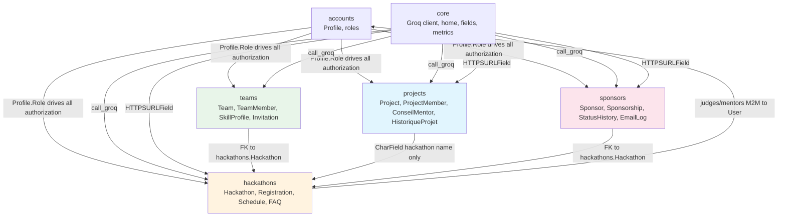

# HackFlow — Comprehensive Audit Report

**Audit date:** 2026-10-26
**Branch:** master
**Scope:** Technical compliance (AGENTS.md) + Business logic / functional architecture
**Method:** Read-only code inspection, plus Django system check, migration check, ruff, and smoke renders against a throwaway SQLite database. No production data was touched. No code was modified.

---

## A. Executive Summary

### Overall state
HackFlow is a Django 5.2 hackathon platform with six Django apps (`accounts`, `core`, `teams`, `hackathons`, `projects`, `sponsors`). The codebase is well-structured, documented, and largely compliant with `AGENTS.md`: Django system check passes (0 issues), `makemigrations --check --dry-run` reports no pending migrations, `ruff check .` passes, and the home page renders 200 against throwaway SQLite. The `projects/` app has a mature service layer (`projects/services.py`) with permission and state-transition functions; the `sponsors/` app has `sponsors/services.py` and `sponsors/permissions.py`; `teams/` has `teams/services.py`. AI goes exclusively through `core.groq.call_groq` with local fallbacks. Cotton components are used correctly (native selects use `c-native_select`).

### Most important technical issues
1. **`hackathons/` has no service layer.** All registration state changes (register, unregister, waitlist promotion, check-in) happen directly in views with no `transaction.atomic()`, no audit trail, and no `HackathonRegistration.Status.CANCELLED` usage. `HackathonRegistration.Status.CANCELLED` is dead code.
2. **Email notifications are implemented but never invoked.** `hackathons/emails.py` has four fully-tested email functions; the calls are commented out in `views.py` (lines 370–371, 438). Participants receive no confirmation/waitlist/promotion emails.
3. **`participant_badge` (hackathons/views.py:634–642) synthesizes a fake registration** with hardcoded values ("ESPRIT", ING3, advanced, ticket "HF-PASS-…") when no registration exists. This violates the AGENTS.md rule against literal demo data.
4. **`Project.hackathon` is a free-text CharField**, not a FK to `hackathons.Hackathon`. Projects cannot be scoped to a real event; the project-hackathon relationship is by name string only.
5. **`change_project_status` (projects/services.py:611) has no source-status precondition.** An organizer can move a DRAFT project directly to FINALIST or WINNER without submission/acceptance. Only `review_project` gates on `REVIEWABLE_STATUSES`.
6. **`project_score` (projects/views.py:498) writes `project.score` directly**, bypassing the service layer (no history entry, no audit).
7. **`resources_link` is `HTTPSURLField` in the model but `URLField` in migration 0001.** `makemigrations --check` reports no drift because `deconstruct()` returns the plain `URLField` path, so this is intentionally stable — but it means the migration does not reflect the actual field class. (Verified: no pending migrations.)
8. **`HackathonRegistration.Status.CANCELLED` is never assigned** anywhere; unregistration deletes the row instead of transitioning to cancelled.
9. **Home page still ships `DEMO_CHALLENGES`, `DEMO_TESTIMONIALS`, `DEMO_FAQS`** (core/views.py:225–344) — explicitly marked as placeholders, acceptable per AGENTS.md, but they are user-facing placeholder content.

### Most important business logic issues
1. **No hackathon lifecycle automation.** `Hackathon.status` transitions are entirely manual (organizer edits the form or admin changes it). There is no code path that moves draft → registration_open → ongoing → judging → finished based on dates. Only `register_participant` gates on `status == REGISTRATION_OPEN`.
2. **No application/review/approval workflow.** Registration is open/closed by status + dates + capacity only. There is no "pending approval" state, no organizer review of registrations.
3. **No certificate model.** AGENTS.md mentions "certificates" under hackathons but the only artifact is a QR-code participant badge (`hackathons/badges.py`). No PDF certificate, no issuance record.
4. **No challenges/tracks/prizes models.** `prize_pool` is a free-text CharField. There is no `Challenge`, `Track`, `Prize`, `Submission`, `Evaluation`, or `Certificate` model anywhere in the codebase.
5. **Teams and projects are disconnected.** `teams.Team` references `hackathons.Hackathon` via FK, but `projects.Project.hackathon` is a CharField. A team's members are not linked to a project; project membership (`ProjectMember`) is a separate, parallel concept with different role vocabularies (`chef_de_projet`/`developpeur`/`designer` vs team roles `leader`/`backend`/`frontend`/`designer`/`data`/`other`).
6. **Mentor advice permission mismatch.** `can_add_mentor_advice` (projects/services.py:471) requires `is_mentor` only, but `can_comment_as_mentor` (line 365) requires `is_mentor AND is_team_member`. The add-advice path does not check team membership, so any mentor can advise any project.
7. **Judging is minimal.** There is no separate evaluation model. Scoring is a single 1–10 `Project.score` field set by an organizer. No rubric, no per-judge scores, no conflict-of-interest checks, no tie-breaking beyond `-updated_at`.
8. **Leaderboard uses `forloop.counter`** as the rank position with no tie handling or gap-free ranking.

### Main architectural weaknesses
- **Module boundary gap:** `projects.Project` does not FK to `hackathons.Hackathon`; it stores a name string. This breaks scoping, filtering, and cross-app workflows.
- **Parallel role systems:** `accounts.Profile.Role` (5 values) vs `teams.TeamMember.Role` (6 values) vs `projects.ProjectMember.Role` (3 values) — three separate vocabularies with no mapping.
- **No service layer in `hackathons/`.** Registration, waitlist promotion, and check-in bypass the service/audit abstraction that `projects/` and `sponsors/` follow.
- **Email infrastructure is dead code.** All four hackathon email functions are implemented and tested but never called.

### Biggest risks to a successful hackathon operation
1. An organizer can publish incomplete results (no validation gate before publishing).
2. Participants receive no email confirmations (registration emails commented out).
3. A DRAFT project can be moved directly to WINNER by an organizer (no source-status precondition in `change_project_status`).
4. Any mentor can advise any project (permission gap).
5. The synthetic badge fallback can display fabricated data to organizers scanning QR codes.

### Confirmed vs. assumed
All findings above are **confirmed** by direct code inspection with file:line references. The only items flagged as open questions are product-scope decisions that cannot be resolved from code (Section J).

---

## B. Existing System Map

### Django apps and responsibilities

| App | Responsibility | Models | Service layer |
|---|---|---|---|
| `accounts` | Custom user profiles, roles, signup, verification, password flows, login rate-limiting | `Profile` (1 model) | None (logic in forms/views) |
| `core` | Landing page, shared Groq client, shared fields/filters, AI metrics, seed demo | None (0 models, 0 migrations) | `core/groq.py`, `core/ai_metrics.py` |
| `teams` | Team creation, membership, invitations, skill profiles, AI teammate matching | `Team`, `TeamMember`, `SkillProfile`, `Invitation` | `teams/services.py` |
| `hackathons` | Events, registrations, schedules, FAQs, AI content, badges, check-in | `Hackathon`, `HackathonSchedule`, `HackathonRegistration`, `HackathonFAQ` | **None** |
| `projects` | Teams (project-level), submissions, reviews, history, AI evaluation, exports | `Project`, `ProjectMember`, `ConseilMentor`, `HistoriqueProjet` | `projects/services.py` (source of truth) |
| `sponsors` | Sponsor pipeline, sponsorships, recommendations, email tooling, reports | `Sponsor`, `Sponsorship`, `StatusHistory`, `SponsorEmailLog` | `sponsors/services.py`, `sponsors/permissions.py` |

### User roles (from `accounts/models.py:Profile.Role`)
`student`, `organizer`, `judge`, `mentor`, `admin` (all English stored values). Additionally, Django's `is_staff`/`is_superuser` flags are used. `Profile.is_organizer_user` inherits admin; `is_student_user` does not.

### Interfaces
- **Front office (public):** `core:home`, `hackathons:list`, `hackathons:detail`, `sponsors:public_list`, `teams:list`, `teams:detail`, `projects:project_list`, `projects:project_detail` (accepted only).
- **Participant area:** `accounts:profile`, `hackathons:register`/`unregister`, `hackathons:participant_badge`, `teams:create`/`join`/`leave`, `teams:skills`, `teams:my_invitations`, `projects:project_create`/`edit`/`submit`/`delete`, `projects:member_add`/`member_remove`.
- **Organizer back office:** `hackathons:dashboard`, `hackathons:create`/`update`/`delete`, `hackathons:export_participants`, `hackathons:organizer_checkin`, `hackathons:toggle_checkin`, `projects:admin_dashboard`, `projects:admin_review`, `projects:project_score`, `projects:ai_metrics`, `sponsors:dashboard`, `sponsors:sponsor_list`/`detail`/`create`/`update`/`delete`, `sponsors:sponsorship_*`, `sponsors:sponsor_contact`, `sponsors:sponsor_export_excel`.
- **Platform administration:** Django admin (`/admin/`) + custom admin dashboard (`projects:admin_dashboard`).

### Primary workflows
1. **Hackathon lifecycle:** Create (draft) → publish → registration opens (manual status) → ongoing → judging → finished → cancelled. All manual.
2. **Registration:** Student registers → confirmed or waitlisted (capacity-based) → can unregister before deadline (waitlist promotion). No approval step.
3. **Project lifecycle:** DRAFT → SUBMITTED → ACCEPTED/REJECTED → (resubmit) → UNDER_REVIEW → FINALIST → WINNER. Service-layer enforced for accept/reject; `change_project_status` lacks source precondition.
4. **Team lifecycle:** Create → invite/join → leave (leader cannot leave) → AI teammate suggestion. Per-hackathon scoping enforced.
5. **Sponsor pipeline:** prospect → contacté → négociation → confirmé → refusé. Service-layer enforced via `change_sponsorship_status`. Email outreach via template or Groq AI.

---

## C. Role and Permission Matrix

| Feature / Action | Anonymous | Student | Organizer | Judge | Mentor | Admin |
|---|---|---|---|---|---|---|
| View public hackathon list/detail | ✅ | ✅ | ✅ | ✅ | ✅ | ✅ |
| View draft/unpublished hackathons | ❌ | ❌ | own only | assigned | assigned | ✅ all |
| Create hackathon | ❌ | ❌ | ✅ | ❌ | ❌ | ✅ |
| Edit/delete hackathon | ❌ | ❌ | own only | ❌ | ❌ | ✅ all |
| Register for hackathon | ❌ | ✅ | ❌ (blocked) | ❌ (blocked) | ❌ (blocked) | ✅ (bypasses) |
| Unregister | ❌ | ✅ (before deadline) | ❌ | ❌ | ❌ | ✅ |
| Export participant CSV | ❌ | ❌ | own only | ❌ | ❌ | ✅ |
| Check-in desk | ❌ | ❌ | ✅ | ✅ (assigned) | ❌ | ✅ |
| View organizer dashboard | ❌ | own registrations | own hackathons | assigned | assigned | ✅ all |
| Create project | ❌ | ✅ | ❌ (unless student role) | ❌ | ❌ | ✅ |
| Edit/submit project (draft/rejected) | ❌ | team member only | ❌ (unless team member) | ❌ | ❌ | ❌ (unless team member) |
| Manage project members | ❌ | project lead only | ❌ | ❌ | ❌ | ❌ |
| Review project (accept/reject) | ❌ | ❌ | ✅ (submitted/under_review) | ❌ | ❌ | ✅ |
| Score project (1–10) | ❌ | ❌ | ✅ | ❌ | ❌ | ✅ |
| Change status to under_review/finalist/winner | ❌ | ❌ | ✅ (any source status) | ❌ | ❌ | ✅ |
| Run AI evaluation | ❌ | team member only | ✅ (not judge/mentor) | ❌ | ❌ | ✅ |
| Add mentor advice | ❌ | ❌ | ❌ | ❌ | ✅ (any project!) | ❌ |
| View mentor advice | ❌ | team member | ✅ | ❌ | ✅ | ✅ |
| View project list (public) | accepted only | own + accepted | all | accepted only | team + accepted | all |
| Manage sponsors (CRUD) | ❌ | ❌ | ✅ | ❌ | ❌ | ✅ |
| View confidential sponsor data | ❌ | ❌ | ✅ | ❌ | ❌ | ✅ |
| Contact sponsors (email) | ❌ | ❌ | ✅ | ❌ | ❌ | ✅ |
| Export sponsorships (Excel) | ❌ | ❌ | ✅ | ❌ | ❌ | ✅ |
| Delete sponsors | ❌ | ❌ | ❌ | ❌ | ❌ | ✅ |
| Team create/join/leave | ❌ | ✅ | ✅ (if student role) | ✅ (if student role) | ✅ (if student role) | ✅ |
| Send team invitations | ❌ | team leader only | team leader only | team leader only | team leader only | team leader only |
| View skill profile edit | ❌ (login req) | ✅ own | ✅ own | ✅ own | ✅ own | ✅ own |
| Django admin | ❌ | ❌ | ❌ (not staff) | ❌ | ❌ | ✅ (staff+superuser) |

**Notes on the matrix:**
- Global permissions (accounts role) vs. event-specific permissions (hackathon organizer/judge/mentor M2M) are conflated in several places. `is_organizer(user)` in `projects/services.py` checks the global role, not whether the user is the organizer of a specific hackathon. This means any user with the `organizer` global role can review/score/change status on **any** project, regardless of which hackathon it belongs to.
- `can_view_project` grants organizers/admins access to all projects including drafts, but there is no per-hackathon scoping because `Project.hackathon` is a string, not a FK.

---

## D. Front Office, Participant Area, and Back Office Audit

### Front office (public)
**Exists:** Home page with featured event, stats, sponsor strip, event catalogue, leaderboard, recent submissions. Hackathon list/detail with filters. Public sponsor list (confirmed only). Project list (accepted only). Team list/detail.

**Belongs:** All of the above is appropriate for public consumption.

**Misplaced/exposed:** The home page `DEMO_CHALLENGES`, `DEMO_TESTIMONIALS`, `DEMO_FAQS` are presented as live content but are hardcoded placeholders. AGENTS.md explicitly permits this ("Challenges, testimonials, and the FAQ currently have no backing models. Their sections remain placeholders"), but they should be clearly labeled as such in the UI or hidden until models exist.

**Missing:** No public event schedule, no public results/rankings page, no public project showcase (only accepted projects are listed, but there is no dedicated showcase). No public announcements.

**Recommended:** Add a "results published" gate before showing winners publicly. Currently `Project.Status.WINNER` and `FINALIST` are visible in the project list if accepted (accepted projects are public), but there is no explicit publication step.

### Participant area
**Exists:** Profile/account management, registration/unregistration, team creation/joining/invitations, skill profile, project CRUD (draft/rejected), submission, member management, mentor advice viewing, AI evaluation (team members only), badge/QR pass.

**Belongs:** All appropriate.

**Misplaced:** `accounts:delete_account` is in the participant area but uses `user.delete()` which cascades to all related data (projects, memberships, registrations). No soft-delete or data export (GDPR). Not a blocker but a risk.

**Missing:** 
- No notification center or announcement feed. Participants cannot see organizer announcements.
- No submission deadline countdown or "next action" guidance on the dashboard.
- No mentorship request/assignment flow (mentors are assigned at the hackathon level, but there is no per-team mentor assignment).
- No feedback loop from judges to participants (scores are internal; no feedback text field).
- `HackathonRegistration` has `portfolio_url`, `motivation`, `skills` but no resume/CV upload.

**Recommended:** Add an announcements model and a participant-facing notification feed. Add a feedback text field to project reviews.

### Organizer back office
**Exists:** Hackathon CRUD, dashboard, participant CSV export, check-in desk, project admin dashboard (KPIs, filters, accept/reject, score, status change, CSV/PDF export), AI metrics dashboard, sponsor dashboard (pipeline, recommendations, email outreach, Excel export).

**Belongs:** All appropriate.

**Misplaced:** The project admin dashboard and AI metrics dashboard are under `projects:` URLs but serve organizer/admin roles. This is fine but could be grouped under a unified `/organizer/` namespace.

**Missing:**
- No event lifecycle automation (manual status changes only).
- No registration approval/rejection workflow.
- No mentor assignment to specific teams (mentors are assigned to hackathons, not teams).
- No judge assignment to specific projects (judges are assigned to hackathons, not projects).
- No results publication step with validation.
- No audit trail for hackathon-level changes (registration state changes are not logged).
- No bulk communication tool (announcements to all participants).

**Recommended:** Create a `hackathons/services.py` mirroring the `projects/services.py` pattern for registration state transitions with audit logging.

### Platform administration
**Exists:** Django admin with customized `ProfileAdmin`, `HackathonAdmin`, `ProjectAdmin`, `SponsorAdmin`, etc. Custom admin dashboard and AI metrics dashboard.

**Belongs:** Django admin is appropriate for superusers.

**Misplaced:** The `set_role_admin` admin action (accounts/admin.py:53–60) sets both `is_staff=True` and `is_superuser=True` on the User model. This is the only path to grant admin privileges. It is correctly guarded by Django admin login, but there is no confirmation prompt or audit log for privilege escalation.

**Missing:** No platform-wide settings management (e.g., global feature flags, default hackathon templates). No user management UI outside Django admin.

---

## E. End-to-End Workflow Audit

### Workflow 1: Hackathon Creation & Publication
**Current flow:** Organizer fills `HackathonForm` (including `status` and `is_published` fields) → `HackathonCreateView` sets `organizer = request.user` → saves. Published via admin action or by setting `is_published=True` in the form.

**Problem:** `status` and `is_published` are both editable by the organizer in the form. An organizer can create a hackathon already in `registration_open` status with `is_published=True`, bypassing any review. There is no "draft → review → publish" workflow.

**Expected:** A new hackathon should start as `draft`/`is_published=False`. Publication should be a deliberate action (already exists as admin action, but not as an organizer-facing button).

**Recommended:** Remove `status` and `is_published` from `HackathonForm` fields; add a dedicated "Publish" action/view that transitions draft → published with validation.

### Workflow 2: Registration
**Current flow:** Student submits `RegistrationForm` → `register_participant` validates role, dates, status, capacity → creates `HackathonRegistration` with `confirmed` or `waitlist` status → (emails commented out).

**Problem:** No confirmation email. No approval step. Capacity check uses `is_full` (confirmed count ≥ max_participants) but `max_participants` defaults to 100 and is not validated against actual venue capacity. No duplicate registration prevention beyond `unique_together`.

**Expected:** Confirmation email on registration. Waitlist promotion email on promotion. (Both implemented in `emails.py` but not called.)

**Recommended:** Uncomment email calls. Add registration confirmation email. Consider adding an approval step for invite-only hackathons.

### Workflow 3: Team Creation & Membership
**Current flow:** Leader creates team → `services.create_team` creates `Team` + `TeamMember(role=LEADER)`. Members join via `join_team` (checks capacity, duplicate membership per hackathon). Invitations via `invite_user` → accept/decline/cancel. AI teammate suggestion via `build_report`.

**Problem:** Teams are per-hackathon (correct), but projects are not linked to hackathons or teams. A team's members do not automatically become project members. There is no "create project from team" flow.

**Expected:** When a team creates a project, all team members should be added as project members automatically.

**Recommended:** Add a "create project from team" flow that links `Project` to the team's hackathon and copies members.

### Workflow 4: Project Submission
**Current flow:** Student creates project (DRAFT) → edits → submits → `services.submit_project` validates permission, sets SUBMITTED, writes history. Organizer reviews → accept/reject (reason mandatory on reject). Rejected projects can be resubmitted.

**Problem:** `change_project_status` allows moving any project (including DRAFT) to UNDER_REVIEW/FINALIST/WINNER without submission or acceptance. No source-status precondition.

**Expected:** Only submitted/accepted projects should be eligible for finalist/winner status.

**Recommended:** Add source-status validation in `change_project_status`: FINALIST requires ACCEPTED, WINNER requires FINALIST (or at least ACCEPTED).

### Workflow 5: Judging & Scoring
**Current flow:** Organizer sets a single 1–10 score via `project_score` view. No per-judge scoring, no rubric, no evaluation model.

**Problem:** Scoring is a single field overwritten by any organizer. No audit trail. No tie-breaking. Judges (role) cannot score — only organizers can.

**Expected:** Judges should be able to score assigned projects. Multiple judges' scores should be aggregated. A rubric should define criteria.

**Recommended:** Create an `Evaluation` model with FK to project, judge, score, criteria, comments, timestamp. Aggregate scores for ranking.

### Workflow 6: Results Publication
**Current flow:** Organizer changes project status to FINALIST/WINNER via admin action or `change_project_status`. No publication gate.

**Problem:** Results are immediately visible (accepted projects are public). There is no "publish results" step that makes winners public only after validation.

**Expected:** Results should be published as a deliberate action after all scoring is complete.

**Recommended:** Add a `results_published` boolean on `Hackathon` and gate public visibility of FINALIST/WINNER status on it.

### Workflow 7: Check-in
**Current flow:** Organizer scans QR code → `organizer_checkin` toggles `checked_in=True`. `toggle_checkin` reverses. Badge page shows a QR code linking to the check-in URL.

**Problem:** The synthetic badge fallback (views.py:634–642) creates a fake registration when none exists, allowing organizers to check in non-existent attendees. No audit trail for check-in actions.

**Expected:** Check-in should require a real registration. Check-in actions should be logged.

**Recommended:** Remove the synthetic fallback. Add a `CheckInLog` model or use `HistoriqueProjet`-style audit.

---

## F. Module Dependency Map

### Existing dependencies (confirmed)
- `accounts` is the root dependency: `Profile.Role` drives authorization in all other apps.
- `core.groq.call_groq` is the single AI gateway used by `hackathons/ai.py`, `projects/ai_service.py`, `sponsors/ai/email_generator.py`, `teams/ai.py`.
- `core.fields.HTTPSURLField` is used by `hackathons`, `projects`, `sponsors`.
- `teams.Team.hackathon` → FK to `hackathons.Hackathon` (correct, after migration 0005).
- `sponsors.Sponsorship.hackathon` → FK to `hackathons.Hackathon` (correct).
- `hackathons.Hackathon.judges/mentors` → M2M to `User` (correct).

### Problematic interactions
- **`projects.Project.hackathon` is a CharField**, not a FK. This is the biggest architectural gap. Projects cannot be scoped to a real hackathon, cannot reference the hackathon's dates/deadlines, and cannot be filtered by hackathon in queries (the admin dashboard filters by `hackathon` string match).
- **`projects` and `teams` are parallel, not integrated.** `teams.Team` (with members) and `projects.Project` (with `ProjectMember`) are separate concepts with different role vocabularies. There is no link between a team and its project submission.
- **`hackathons` has no service layer**, unlike `projects` and `sponsors`. Registration state changes bypass the audit/transaction pattern.
- **`core` has zero models.** The home page computes stats from other apps' models. This is fine but means `core` cannot store platform-level configuration.

### Recommended future relationships
- `projects.Project.hackathon` → FK to `hackathons.Hackathon` (replacing CharField).
- `projects.Project.team` → FK to `teams.Team` (optional, linking submission to team).
- `hackathons.HackathonRegistration` → link to `teams.Team` (optional, tracking which team a participant is on).
- Create `hackathons/services.py` for registration state transitions with audit logging.

---

## G. Findings Register

| ID | Category | Finding | Evidence | Impact | Severity | Recommended Action |
|---|---|---|---|---|---|---|
| TECH-001 | Technical | `hackathons/` has no service layer; registration state changes bypass service/audit/transaction pattern | `hackathons/views.py:349–366` (direct `HackathonRegistration(status=...).save()`), `:419` (direct `.delete()`), `:436–437` (direct status update), `:677–680` (direct check-in save) | No audit trail, no transaction safety, inconsistent with projects/sponsors pattern | High | Create `hackathons/services.py` with `register_participant`, `unregister_participant`, `check_in` functions wrapped in `transaction.atomic()` with audit logging |
| TECH-002 | Technical | Email notifications implemented but never invoked | `hackathons/views.py:370–371` and `:438` (commented-out calls); `hackathons/emails.py:8–201` (four functions); `hackathons/tests_ai_emails.py` (tests pass) | Participants receive no confirmation/waitlist/promotion emails | High | Uncomment email calls; verify SMTP config in production |
| TECH-003 | Technical | Synthetic badge fallback creates fabricated registration | `hackathons/views.py:633–642` (hardcoded "ESPRIT", ING3, advanced, "HF-PASS-…") | Organizers can check in non-existent attendees; violates demo-data rule | Medium | Remove synthetic fallback; return 404 or redirect when no registration exists |
| TECH-004 | Technical | `Project.hackathon` is a CharField, not a FK | `projects/models.py:62–68` (CharField, max_length=150, default="HackFlow 2026"); `projects/forms.py:13` (text input) | Projects cannot be scoped to a real event; filtering is by name string | High | Add FK to `hackathons.Hackathon`; migrate data; update forms/views |
| TECH-005 | Technical | `change_project_status` lacks source-status precondition | `projects/services.py:611–633` (no check on current status before setting FINALIST/WINNER) | DRAFT project can be moved directly to WINNER | High | Add precondition: FINALIST requires ACCEPTED, WINNER requires FINALIST |
| TECH-006 | Technical | `project_score` writes directly to model, bypassing service layer | `projects/views.py:511–512` (direct `project.score = score_val; project.save()`) | No audit trail for scoring; inconsistent with service pattern | Medium | Add `services.score_project()` with permission check and optional history entry |
| TECH-007 | Technical | `HackathonRegistration.Status.CANCELLED` is dead code | `hackathons/models.py:312–315` (CANCELLED choice); never assigned anywhere | Unregistration deletes the row; no cancelled state for audit | Medium | Either use CANCELLED status in unregister (soft-delete) or remove the choice |
| TECH-008 | Technical | `resources_link` type mismatch between model and migration | `hackathons/models.py:137` (HTTPSURLField); `hackathons/migrations/0001_initial.py:136` (URLField); `core/fields.py:22` (deconstruct returns URLField path) | Intentionally stable (no pending migrations), but migration does not reflect field class | Low | Documented design choice; no action needed unless migration fidelity is required |
| TECH-009 | Technical | Home page ships placeholder demo content | `core/views.py:225–344` (DEMO_CHALLENGES, DEMO_TESTIMONIALS, DEMO_FAQS); `templates/core/home.html` renders them | User-facing placeholder content presented as live | Low | Acceptable per AGENTS.md; consider hiding sections until models exist |
| TECH-010 | Technical | `HackathonRegistration` has no `cancelled` transition; unregister deletes row | `hackathons/views.py:419` (direct `.delete()`) | Waitlist promotion works but no audit of who cancelled | Medium | Soft-delete via status change + audit log |
| TECH-011 | Technical | `participant_badge` falls back to first registration in hackathon when user has none | `hackathons/views.py:629–632` (any registration in hackathon) | Organizer scanning badge sees another participant's data | Medium | Restrict to user's own registration; return 403/404 otherwise |
| TECH-012 | Technical | `HackathonForm` exposes `status` and `is_published` to organizers | `hackathons/forms.py:73–74` (both in fields list) | Organizer can publish without review; bypasses draft→publish workflow | Medium | Remove from form; add dedicated publish action |
| TECH-013 | Technical | `project_create` sets status to DRAFT directly (not via service) | `projects/views.py:198` (direct assignment) | Acceptable (DRAFT is the only legal initial state), but inconsistent pattern | Low | Document as intentional; no action needed |
| TECH-014 | Technical | `project_delete` deletes directly (not via service) | `projects/views.py:283` (direct `.delete()`) | No soft-delete or audit; acceptable for drafts | Low | Document; consider soft-delete if audit needed |
| TECH-015 | Technical | `member_add`/`member_remove` write directly (not via service) | `projects/views.py:306, 324` | No audit trail for team membership changes | Low | Consider adding `services.add_member()`/`remove_member()` |
| TECH-016 | Technical | `is_organizer` in projects/services.py checks global role, not per-hackathon | `projects/services.py:34–38` (role check only); no hackathon FK on Project to scope | Any organizer can review/score any project regardless of event | High | Scope permissions by hackathon once Project.hackathon becomes a FK |
| TECH-017 | Technical | `can_add_mentor_advice` does not check team membership | `projects/services.py:471–474` (only `is_mentor`) vs `can_comment_as_mentor` (line 365, requires `is_team_member`) | Any mentor can advise any project | Medium | Align: require `is_mentor AND is_team_member` (or assigned mentor) |
| TECH-018 | Technical | Leaderboard has no tie handling beyond `-updated_at` | `core/views.py:376–381` (order_by "-score", "-updated_at"); `templates/core/home.html:140` (forloop.counter as rank) | Ties displayed with arbitrary ordering | Low | Add explicit tie-breaker or group ties |
| TECH-019 | Technical | `HackathonRegistration` has no `cancelled` transition; unregister deletes row | `hackathons/views.py:419` | No audit of cancellations; waitlist promotion works but row is gone | Medium | Soft-delete via status (see TECH-007) |
| TECH-020 | Technical | `Hackathon` status transitions are entirely manual | `hackathons/views.py` (no status change logic); `hackathons/forms.py:73` (status in form) | No automated lifecycle progression | Medium | Add date-based status transitions or explicit lifecycle actions |
| TECH-021 | Technical | `set_role_admin` admin action flips is_staff/is_superuser without confirmation/audit | `accounts/admin.py:53–60` | Privilege escalation with no audit trail | Medium | Add confirmation prompt and audit log |
| TECH-022 | Technical | `base.html` skip link is bilingual (French + English) | `templates/base.html:58` ("Aller au contenu principal / Skip to main content") | User-facing French text (AGENTS.md requires English) | Low | Translate to English only |
| TECH-023 | Technical | `innerHTMl` usage in templates (HTMX swap targets, safe JSON) | `templates/sponsors/sponsor_contact.html:112,142` (hx-swap="innerHTML"); `templates/cotton/combobox/index.html:15` (safe JSON) | HTMX innerHTML swaps are standard; combobox JSON is server-generated | Low | Acceptable; no user content injected via innerHTML |
| TECH-024 | Technical | `HackathonRegistration.clean()` validates registration window but view also checks | `hackathons/models.py:440–450`; `hackathons/views.py:315–334` | Duplicate validation; not a bug but redundant | Low | Consolidate into service layer |
| TECH-025 | Technical | No `HackathonSchedule`/`HackathonFAQ` admin registration (inlines only) | `hackathons/admin.py` (inlines in HackathonAdmin) | Cannot manage schedules/FAQs independently | Low | Acceptable; inlines are sufficient |

| BIZ-001 | Business | No hackathon lifecycle automation or publication gate | `hackathons/views.py` (no status transitions); `hackathons/forms.py:73–74` (status/is_published editable) | Organizers can publish incomplete events; no review step | High | Add draft→review→publish workflow |
| BIZ-002 | Business | No application/review/approval workflow for registrations | `hackathons/views.py:291–396` (open registration only) | Cannot run invite-only or gated hackathons | Medium | Add optional approval step (status=pending→confirmed) |
| BIZ-003 | Business | No certificate model; only QR badge exists | `hackathons/badges.py` (QR only); no Certificate model anywhere | Cannot issue verifiable credentials | Medium | Add Certificate model if product requires it |
| BIZ-004 | Business | No challenges/tracks/prizes models | `hackathons/models.py` (only `prize_pool` CharField); no Challenge/Track/Prize model | Cannot manage structured challenges or tracks | Medium | Add models when product scope requires |
| BIZ-005 | Business | Teams and projects are disconnected | `teams/models.py:Team` (FK to hackathon); `projects/models.py:Project` (CharField hackathon, no team link) | Team members don't auto-become project members | High | Link Project to Team; auto-copy members on creation |
| BIZ-006 | Business | Three parallel role vocabularies with no mapping | `accounts/models.py:Profile.Role` (5 values); `teams/models.py:TeamMember.Role` (6 values); `projects/models.py:ProjectMember.Role` (3 values) | Confusing; no single source of truth for "what a person does" | Medium | Document mapping; consider unifying |
| BIZ-007 | Business | Judging is a single score field, no rubric, no per-judge | `projects/models.py:Project.score` (PositiveSmallInt); `projects/views.py:498` (organizer only) | No multi-judge evaluation; judges (role) cannot score | High | Create Evaluation model with per-judge scores and rubric |
| BIZ-008 | Business | No results publication gate | `projects/services.py:611` (any organizer can set WINNER); `core/views.py:376` (leaderboard shows scored projects) | Winners visible before validation | Medium | Add `results_published` gate on Hackathon |
| BIZ-009 | Business | Mentor advice permission gap (any mentor → any project) | `projects/services.py:471` (`is_mentor` only) vs `:365` (`is_mentor AND is_team_member`) | Unauthorized advice injection | Medium | Align permission checks |
| BIZ-010 | Business | No mentor assignment to teams (only hackathon-level) | `hackathons/models.py:Hackathon.mentors` (M2M to User); no team-mentor link | Mentors cannot be scoped to specific teams | Low | Add optional team-mentor FK if needed |
| BIZ-011 | Business | No judge assignment to projects (only hackathon-level) | `hackathons/models.py:Hackathon.judges` (M2M to User); no project-judge link | Judges see all accepted projects, not assigned ones | Medium | Add project-judge assignment |
| BIZ-012 | Business | No announcements/notifications model | No Announcement model anywhere | Participants cannot receive event updates | Medium | Add Announcement model with read tracking |
| BIZ-013 | Business | No feedback text from judges to participants | `projects/models.py:Project.rejection_reason` (only rejection reason); no feedback field | Participants don't receive constructive feedback | Medium | Add feedback field to review/evaluation |
| BIZ-014 | Business | `is_organizer` is global role, not per-hackathon | `projects/services.py:34–38` | Any organizer can manage any event's projects | High | Scope by hackathon once Project.hackathon is a FK |
| BIZ-015 | Business | No soft-delete or data export for account deletion | `accounts/views.py:232–237` (hard `user.delete()`) | GDPR risk; cascading data loss | Medium | Add soft-delete + data export |
| BIZ-016 | Business | `can_view_project` grants organizers access to all drafts | `projects/services.py:95–130` | Any organizer sees all draft projects | Medium | Scope to hackathon organizer |
| BIZ-017 | Business | No tie-breaking in rankings beyond `-updated_at` | `core/views.py:376–381` | Arbitrary ordering for tied scores | Low | Add explicit tie-breaker |
| BIZ-018 | Business | `HackathonRegistration` has `portfolio_url`, `motivation`, `skills` but no resume upload | `hackathons/models.py:385–395` | Cannot collect CVs for sponsor/judge review | Low | Add FileField if needed |
| BIZ-019 | Business | `max_participants` defaults to 100; capacity not validated against venue | `hackathons/models.py:105` (default=100) | Overbooking risk | Low | Add validation or make required |
| BIZ-020 | Business | `tshirt_dietary` is a free-text CharField | `hackathons/models.py:385–389` | Inconsistent data; hard to aggregate | Low | Consider structured choices |

| FLOW-001 | Workflow | No automated status progression for hackathons | `hackathons/views.py` (manual only) | Events can get stuck in wrong status | Medium | Add lifecycle actions or date-based transitions |
| FLOW-002 | Workflow | Waitlist promotion has no email notification | `hackathons/views.py:438` (commented out) | Promoted participants don't know | High | Uncomment `send_waitlist_promoted_email` |
| FLOW-003 | Workflow | No "next action" guidance for participants | `templates/hackathons/detail.html` (no status-aware CTA) | Participants don't know what to do next | Medium | Add status-aware CTAs |
| FLOW-004 | Workflow | No registration approval/rejection workflow | `hackathons/views.py:291–396` | Cannot gate registration | Medium | Add optional approval step |
| FLOW-005 | Workflow | No mentor assignment to teams | `hackathons/models.py:mentors` (hackathon-level only) | Mentors can't be scoped to teams | Low | Add team-mentor link if needed |
| FLOW-006 | Workflow | No judge assignment to projects | `hackathons/models.py:judges` (hackathon-level only) | Judges see all accepted projects | Medium | Add project-judge assignment |
| FLOW-007 | Workflow | No results publication step | `projects/services.py:611` (direct status change) | Winners visible before validation | Medium | Add `results_published` gate |
| FLOW-008 | Workflow | Check-in has no audit trail | `hackathons/views.py:677–680` (direct save) | No record of who checked in whom | Low | Add check-in audit log |

| PERM-001 | Permission | Mentor can advise any project (no team membership check) | `projects/services.py:471–474` | Unauthorized advice injection | Medium | Add `is_team_member` check |
| PERM-002 | Permission | Any organizer can review/score any project (global role, no hackathon scoping) | `projects/services.py:34–38`, `:332–346`, `:384–412` | Cross-event unauthorized access | High | Scope by hackathon FK |
| PERM-003 | Permission | `can_view_project` grants organizers access to all drafts | `projects/services.py:95–130` | Draft leakage to non-event organizers | Medium | Scope by hackathon |
| PERM-004 | Permission | `participant_badge` shows another user's registration when user has none | `hackathons/views.py:629–632` | Data leakage | Medium | Restrict to own registration |
| PERM-005 | Permission | `toggle_checkin` sets `checked_in_at` even when unchecking (actually sets None — verified correct) | `hackathons/views.py:716–718` | N/A (verified correct) | Low | No action |
| PERM-006 | Permission | `set_role_admin` grants superuser without confirmation/audit | `accounts/admin.py:53–60` | Privilege escalation risk | Medium | Add confirmation + audit |

| ARCH-001 | Architecture | `projects.Project` does not FK to `hackathons.Hackathon` | `projects/models.py:62–68` | Cannot scope projects to events | Critical | Add FK, migrate, update queries |
| ARCH-002 | Architecture | `teams` and `projects` are parallel, unintegrated systems | `teams/models.py` + `projects/models.py` (no cross-references) | Team members don't auto-become project members | High | Link Project to Team; auto-copy members |
| ARCH-003 | Architecture | `hackathons` has no service layer | No `hackathons/services.py` exists | Inconsistent with projects/sponsors pattern | High | Create service layer |
| ARCH-004 | Architecture | Three parallel role vocabularies | `accounts`, `teams`, `projects` models | Confusing; no single source of truth | Medium | Document mapping; consider unifying |
| ARCH-005 | Architecture | Email infrastructure is dead code | `hackathons/emails.py` (4 functions, never called) | No participant notifications | High | Wire up email calls |
| ARCH-006 | Architecture | `core` has zero models | No `core/models.py` | Cannot store platform config | Low | Acceptable; config via settings |

---

## H. Recommended Target Behavior

### Roles and interfaces
- **Anonymous visitor:** Public hackathon catalogue, event details, confirmed sponsor strip, accepted project showcase, FAQ (until real models exist).
- **Student/Participant:** Registration, team management, project creation/submission, badge, mentor advice viewing, AI evaluation (team members only). No access to organizer dashboards.
- **Organizer (event-scoped):** Manage their own hackathons (CRUD, publish, registration oversight, CSV export, check-in). Review/score projects scoped to their hackathons. Manage sponsors. No access to other organizers' events.
- **Judge:** View assigned projects only. Score via rubric. No project editing or status changes.
- **Mentor:** View mentored projects/teams. Add advice to assigned teams only. No scoring.
- **Admin (platform):** Full access via Django admin + custom dashboards. User/role management. Cross-event oversight. Privilege escalation with audit.

### Interface separation
- **Front office:** Public data only. No admin controls. No draft/unpublished content.
- **Participant area:** Self-service only. No organizer tools. Clear "next action" guidance.
- **Organizer back office:** Event-scoped management. No cross-event access unless admin.
- **Platform admin:** User management, global settings, cross-event oversight. Separate from organizer tools.

### Hackathon lifecycle (recommended)
1. **Draft** — organizer creates, configures, assigns judges/mentors.
2. **Published** — organizer publishes (deliberate action, not form field).
3. **Registration Open** — automatic or manual transition when registration_start is reached.
4. **Registration Closed** — automatic when registration_deadline passes.
5. **Ongoing** — automatic when start_date is reached.
6. **Judging** — automatic when end_date is reached, or manual.
7. **Results Published** — deliberate action after scoring complete.
8. **Finished** — automatic after results published.
9. **Cancelled** — manual, with notification to registrants.

### Module interactions (recommended)
- `Project.hackathon` → FK to `Hackathon` (not CharField).
- `Project.team` → optional FK to `Team`.
- `HackathonRegistration` → optional FK to `Team`.
- `Evaluation` model → FK to Project + Judge, with score + rubric + comments.
- `hackathons/services.py` → registration state transitions with audit.
- `projects/services.py` → add `score_project()`, `publish_results()`.
- Email calls → wired up in registration/unregister/promotion flows.

### Business rules to enforce
1. Registration requires `status == REGISTRATION_OPEN` and within date window.
2. Capacity enforcement: confirmed count ≤ max_participants; overflow → waitlist.
3. Unregistration before deadline only; waitlist promotion on confirmed cancellation.
4. Project submission requires DRAFT/REJECTED status, team membership, before deadline.
5. Project review (accept/reject) requires SUBMITTED/UNDER_REVIEW status.
6. Status changes to FINALIST/WINNER require prior ACCEPTED status.
7. Scoring requires organizer/admin role and project in reviewable status.
8. Results publication requires all projects scored.
9. Mentor advice requires mentor role and team membership (or assignment).
10. Permission checks must be event-scoped, not global-role-only.

### Assumptions requiring product-owner confirmation
- Whether hackathons should support an approval step for registration (invite-only events).
- Whether certificates (PDF/verifiable credentials) are in scope.
- Whether challenges/tracks/prizes models are needed or if free-text `prize_pool` suffices.
- Whether mentors should be assigned to teams or hackathons.
- Whether judges should score via rubric or single score.
- Whether account deletion should be soft or hard delete.
- Whether `HackathonRegistration.Status.CANCELLED` should be used (soft-delete) or removed.

---

## I. Prioritized Remediation Roadmap

### Priority 0 — Critical fixes
| # | Finding IDs | Action | Verification |
|---|---|---|---|
| 1 | ARCH-001, TECH-004, BIZ-005, PERM-002, PERM-003, BIZ-014, BIZ-016 | Add `Project.hackathon` FK to `Hackathon`; migrate data; scope all project permissions by hackathon | `makemigrations --check --dry-run` passes; project queries filter by hackathon; organizer of hackathon A cannot access hackathon B's projects |
| 2 | TECH-005, BIZ-008, FLOW-007 | Add source-status precondition to `change_project_status` (FINALIST requires ACCEPTED, WINNER requires FINALIST) | Attempting to move DRAFT → WINNER raises ValueError; test covers transition matrix |
| 3 | TECH-003, TECH-011, PERM-004 | Remove synthetic badge fallback; restrict to own registration | Badge page returns 404 for non-registered users; no fabricated data |
| 4 | TECH-017, PERM-001, BIZ-009 | Align mentor advice permission to require team membership | Non-team mentor gets 403 on `project_add_mentor_advice` |

### Priority 1 — Core functionality
| # | Finding IDs | Action | Verification |
|---|---|---|---|
| 5 | TECH-001, ARCH-003, TECH-010, TECH-019 | Create `hackathons/services.py` with registration state transitions + audit | Registration changes wrapped in `transaction.atomic()`; audit log entries created |
| 6 | TECH-002, ARCH-005, FLOW-002 | Uncomment and verify email calls in register/unregister | Emails sent on registration, waitlist, promotion; tests pass |
| 7 | BIZ-007, FLOW-006, BIZ-011 | Create `Evaluation` model with per-judge scores and rubric | Judges can score assigned projects; scores aggregated for ranking |
| 8 | TECH-012, BIZ-001, FLOW-001 | Remove `status`/`is_published` from `HackathonForm`; add publish action | New hackathons start as draft/unpublished; publish is deliberate |
| 9 | TECH-006 | Add `services.score_project()` with permission check | Scoring goes through service layer |

### Priority 2 — Functional consistency
| # | Finding IDs | Action | Verification |
|---|---|---|---|
| 10 | ARCH-002, BIZ-005 | Link `Project` to `Team`; auto-copy members on creation | Team members become project members automatically |
| 11 | TECH-016, PERM-002, PERM-003, BIZ-014, BIZ-016 | Scope organizer permissions by hackathon (requires ARCH-001) | Organizer of hackathon A cannot access hackathon B's projects |
| 12 | BIZ-012, FLOW-003 | Add `Announcement` model with read tracking | Participants see announcements on dashboard |
| 13 | BIZ-013, FLOW-003 | Add feedback text field to project reviews | Participants receive constructive feedback |
| 14 | TECH-021, PERM-006 | Add confirmation prompt + audit for `set_role_admin` | Admin role grant requires confirmation; audit log entry created |
| 15 | BIZ-008, FLOW-007 | Add `results_published` gate on Hackathon | Winners not public until published |
| 16 | TECH-015 | Add `services.add_member()`/`remove_member()` for project members | Member changes go through service layer |
| 17 | TECH-007, TECH-010, TECH-019 | Use `CANCELLED` status in unregister (soft-delete) or remove choice | Consistent state; no dead code |
| 18 | BIZ-006, ARCH-004 | Document role vocabulary mapping | Clear mapping between accounts/teams/projects roles |

### Priority 3 — Improvements
| # | Finding IDs | Action | Verification |
|---|---|---|---|
| 19 | TECH-009 | Hide or label placeholder sections (challenges/testimonials/FAQ) | Sections clearly marked as "coming soon" or hidden |
| 20 | TECH-022 | Translate skip link to English | No French in `base.html` |
| 21 | TECH-018, BIZ-017 | Add explicit tie-breaking in leaderboard | Ties displayed consistently |
| 22 | BIZ-003 | Add Certificate model if in scope (product decision) | Certificates generated and verifiable |
| 23 | BIZ-004 | Add Challenge/Track/Prize models if in scope (product decision) | Structured challenge management |
| 24 | BIZ-010, FLOW-005 | Add team-mentor assignment if needed | Mentors scoped to teams |
| 25 | BIZ-015 | Add soft-delete + data export for account deletion | GDPR compliance |
| 26 | BIZ-018, BIZ-019, BIZ-020 | Add resume upload, capacity validation, structured dietary choices | Better data quality |
| 27 | TECH-025 | Register Schedule/FAQ as standalone admin (optional) | Independent management |
| 28 | TECH-014 | Consider soft-delete for projects | Audit trail for deleted projects |

---

## J. Open Questions and Unverified Areas

1. **Should registration support an approval step (invite-only events)?** The current model has no "pending" status. Adding one would require a new `HackathonRegistration.Status.PENDING` value and organizer review UI. Affects: BIZ-002, FLOW-004.

2. **Are certificates (PDF/verifiable credentials) in scope?** AGENTS.md mentions "certificates" under hackathons, but no model exists. Only a QR badge is implemented. Affects: BIZ-003.

3. **Are challenges/tracks/prizes models needed, or is free-text `prize_pool` sufficient?** The home page has placeholder challenges with no backing model. Affects: BIZ-004, TECH-009.

4. **Should mentors be assigned to teams or hackathons?** Currently hackathon-level only. Team-level assignment would require a new FK. Affects: BIZ-010, FLOW-005.

5. **Should judges score via rubric or single score?** Currently a single 1–10 field. A rubric would require an `Evaluation` model with criteria. Affects: BIZ-007, FLOW-006.

6. **Should account deletion be soft or hard?** Currently hard delete with cascading. GDPR may require soft-delete + data export. Affects: BIZ-015.

7. **Should `HackathonRegistration.Status.CANCELLED` be used (soft-delete on unregister) or removed?** Currently dead code. Affects: TECH-007, TECH-010, TECH-019.

8. **Should `Project.hackathon` become a FK or remain a CharField for flexibility?** A FK enables scoping but requires migration and data cleanup. Affects: ARCH-001, all PERM findings.

9. **Should the `is_organizer` global role be replaced by per-hackathon organizer assignment?** Currently any user with the `organizer` role can manage any hackathon. Event-scoped organizers would require a new `HackathonOrganizer` model or M2M. Affects: PERM-002, PERM-003, BIZ-014, BIZ-016.

10. **Is the `DEMO_*` placeholder content on the home page acceptable for production, or should it be hidden?** AGENTS.md explicitly permits placeholders, but they are user-facing. Affects: TECH-009.

---

## Verification Summary

| Check | Result |
|---|---|
| `.venv/bin/python manage.py check` | ✅ 0 issues |
| `.venv/bin/python manage.py makemigrations --check --dry-run` | ✅ No changes detected |
| `ruff check .` | ✅ All checks passed |
| Template smoke (home, detail, project_detail) | ✅ All templates load |
| Home page render (throwaway SQLite) | ✅ HTTP 200, 100,816 bytes |
| Demo data seed (throwaway SQLite) | ✅ 4 teams, 9 members, 18 registrations, 9 sponsors |
| Forbidden AI providers (Gemini/Anthropic/OpenAI) | ✅ Only `core.groq` used (Anthropic mention is in AI prompt text about permitted tools, not a client) |
| `textContent`/`innerHTML` in templates | ✅ Only HTMX swap targets and safe JSON; no user content injection |
| `c-select` vs `c-native_select` | ✅ All native selects use `c-native_select` |
| French user-facing text | ✅ Only stored-value comparisons in sponsor templates + bilingual skip link |
| Demo/placeholder content | ✅ Explicitly marked in source; acceptable per AGENTS.md |

---

*This report is based on read-only code inspection. No files were modified during the audit.*
